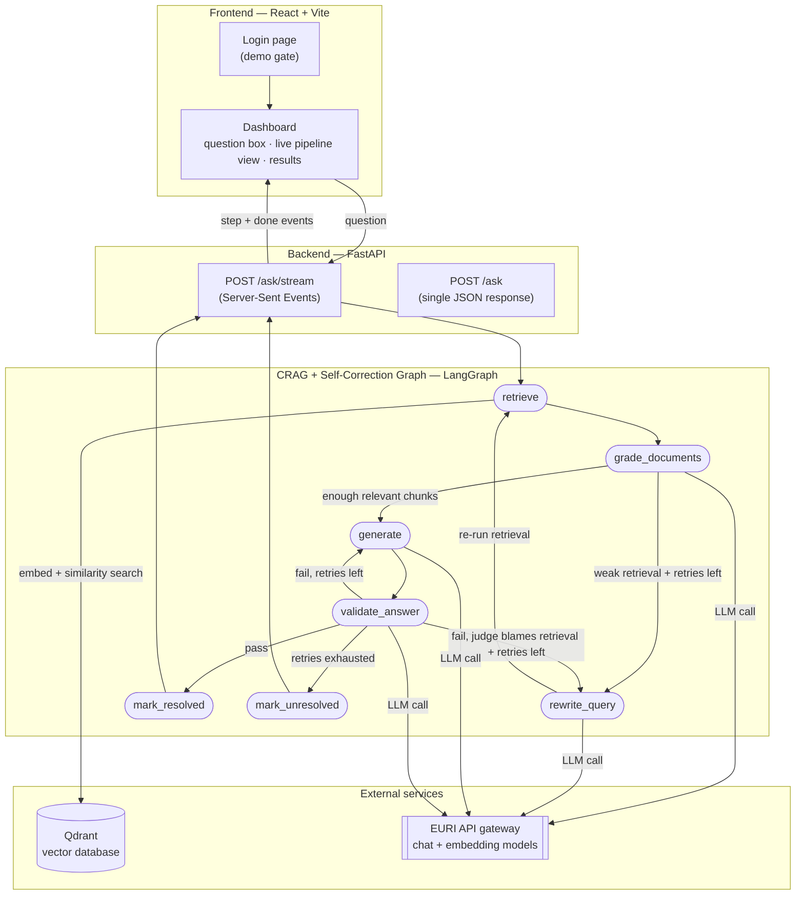
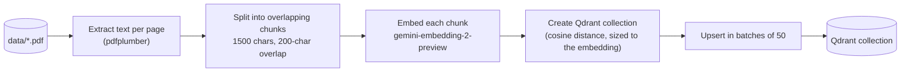

# VeriLex — Self-Correcting Compliance Research Assistant

A Corrective RAG (CRAG) + Self-Correcting RAG agent that answers regulatory/compliance questions grounded in a fintech document library (PCI DSS, FCA Payment Services Regulations, PFMI, cross-border payments standards, payment methods), with a React frontend and a FastAPI backend on top.

---

## 1. The business problem

Compliance teams at a payments company need fast, trustworthy answers to questions like *"How does PCI DSS relate to our obligations under the FCA's Payment Services Regulations?"* — without manually searching hundreds of pages across multiple regulatory PDFs.

A naive RAG chatbot is risky here: it can retrieve irrelevant passages and answer from them anyway, or generate a confident-sounding answer that isn't actually grounded in the source material. In a compliance context, a hallucinated answer isn't just wrong — it's the kind of wrong that leads to real regulatory exposure.

This project is a RAG pipeline that **checks its own work at two points**: it grades whether what it retrieved is actually relevant before answering, and it evaluates its own generated answer for grounding, hallucination risk, and completeness before returning it — retrying automatically when either check fails, within a bounded number of attempts.

---

## 2. What is CRAG and what is a Self-Correcting RAG Agent?

**Corrective RAG (CRAG)** is a RAG variant where the retrieval step is treated as untrusted by default. Instead of feeding every retrieved chunk straight into the answer, the system grades each chunk as relevant or irrelevant. If too few chunks are relevant, it rewrites the search query and retries retrieval — capped at a maximum number of retries so it can't loop forever.

**Self-Correcting RAG Agent** goes a step further: after the answer is generated, the agent evaluates *its own answer* — is it grounded in the retrieved context, what's the hallucination risk, is it complete, and was the retrieved context itself insufficient to answer well? If the answer fails this check, the agent retries — either regenerating the answer or looping back to fix retrieval — again capped at a maximum retry count.

## 3. CRAG vs. Self-Correcting RAG Agent — what's the actual difference?

They correct **different stages** of the pipeline:

| | Corrects | When it fires | What it changes |
|---|---|---|---|
| **CRAG** | The *input* to generation | Before the answer is written | Rewrites the search query, re-retrieves documents |
| **Self-Correcting RAG Agent** | The *output* of generation | After the answer is written | Regenerates the answer, or loops back to retrieval if the judge blames the context |

This project implements both as a single combined graph: CRAG handles retrieval-side correction, and the self-correction layer wraps around generation as an outer validation loop — including the ability for validation failures to trigger a fresh CRAG retrieval cycle, not just a re-generation.

---

## 4. The CRAG pipeline

```
Question → Retrieve → Grade Documents → [weak? Rewrite Query → Retrieve again] → Generate → Validate → [fail? Retry] → Resolved / Unresolved
```

- **Retrieve** — embeds the question and pulls the top-5 most similar chunks from Qdrant.
- **Grade Documents** — one LLM call grades every retrieved chunk as `relevant`/`irrelevant`.
- **Rewrite Query** — fires only if fewer than half the chunks are relevant *and* retries remain; rewords the query using the original question plus the failed query, then retrieval runs again.
- **Generate** — writes the answer using only the chunks graded `relevant`, always addressing the *original* question even if the search query was rewritten.
- **Validate** — one LLM call checks four things at once: is the answer grounded, what's the hallucination risk (low/medium/high), is it complete, and was retrieval itself insufficient.
- **Retry logic** — on a failed validation: if the judge blames retrieval and retries remain, loop back to `rewrite_query`; otherwise regenerate the answer. Once retries are exhausted, the run ends as `resolved` or `unresolved` regardless.

Retry limits (`max_retrieval_retries`, `max_validation_retries`) default to 2 each and are what prevent infinite loops.

---

## 5. Architecture



The frontend calls `/ask/stream`, which streams one event per graph node as it actually completes — so the UI shows live progress (including retries) instead of a blank screen until the whole run finishes. `/ask` is a simpler, non-streaming equivalent that returns the same final payload in one response.

---

## 6. Data ingestion pipeline

Run once (or whenever the source documents change), before asking any questions:



Each chunk is stored with its source filename and page number as payload, so every answer can cite exactly where it came from.

---

## 7. Models used and observed latency

Three chat models were evaluated against the same EURI API gateway during development. Numbers below are averaged from real runs of this pipeline (multiple LLM calls per question: grading, possibly rewriting, generation, validation).

| Model | Role | Reliability observed | Typical latency per call | Notes |
|---|---|---|---|---|
| `gemini-embedding-2-preview` | Embeddings (ingestion + query time) | Reliable | ~0.6 – 1.2s | 3072-dimension vectors |
| `gemini-2.5-flash` | Early "fast" model for grading/rewriting/validation | **Unreliable** | 6s – 380s+ per call, frequent 5xx/timeout errors | Dropped after EURI dashboard confirmed the backend itself was overloaded, not our prompts |
| `kimi-k3` | Original default chat model | Reliable (small sample) | ~24 – 50s per call | Consistent but only tested lightly before switching |
| `gpt-5.6-sol` | **Current model — used for every node** | Reliable, zero observed errors | ~1.3 – 16.2s per call, ~20 – 70s total per full question (3–9 chained calls depending on retries) | Standardized on this after direct comparison; fastest and most consistent of the three |

The app also includes built-in retry/backoff around every chat model call (3 attempts, exponential backoff) to absorb any future transient provider errors without failing the whole run.

---

## Screenshots

**Sign in** — a demo-only gate in front of the assistant.


**Asking a question** — live pipeline progress streams in as each graph node actually completes.


**Result** — grounded answer with citations, resolution status, retry counts, token/time stats, and the graded source chunks.


---

## 8. Running locally

### Prerequisites

- Python 3.11+
- Node.js 18+
- A [Qdrant Cloud](https://cloud.qdrant.io) cluster (free tier works)
- An [EURI](https://api.euron.one) API key (chat model)
- A [Jina](https://jina.ai) API key (embeddings)

### Step 1 — Clone and create the Python environment

```bash
git clone https://github.com/Rashid251/VeriLex.git
cd VeriLex

python -m venv .venv

# Windows (PowerShell)
.\.venv\Scripts\Activate.ps1

# macOS / Linux
source .venv/bin/activate

pip install -r requirements.txt
```

### Step 2 — Configure environment variables

```bash
# Backend
cp .env.example .env

# Frontend
cp frontend/.env.example frontend/.env
```

Open `.env` and fill in your real values. Minimum required to run the web app locally:

```env
# Chat model (EURI)
EURI_API_KEY=your-euri-api-key
EURI_BASE_URL=https://api.euron.one/api/v1/euri
CHAT_MODEL=gpt-5.6-sol

# Embeddings (Jina)
JINA_API_KEY=your-jina-api-key
JINA_BASE_URL=https://api.jina.ai/v1
JINA_EMBED_MODEL=jina-embeddings-v3

# Vector database (Qdrant)
QDRANT_URL=https://your-cluster.qdrant.io
QDRANT_API_KEY=your-qdrant-api-key
QDRANT_COLLECTION=verilex

# SQLite auth database
DATABASE_URL=sqlite:///./app.db

# Session security — generate with:
#   python -c "import secrets; print(secrets.token_hex(32))"
SECRET_KEY=replace-with-a-long-random-secret

# CORS
FRONTEND_URL=http://localhost:5173

# Cookie settings (false = no HTTPS required locally)
COOKIE_SECURE=false
```

`frontend/.env` only needs one line:
```env
VITE_API_URL=http://localhost:8000
```

### Step 3 — Ingest documents (one-time setup)

Drop your PDFs into `data/`, then:

```bash
python -m rag.ingest
```

This embeds every chunk with Jina and uploads it to your Qdrant collection. You only need to run this once (or again when documents change).

> **Note:** Qdrant is **not** touched by the auth layer — it is purely the vector store for RAG retrieval.

### Step 4 — Run the backend

```bash
uvicorn api.server:app --port 8000 --reload
```

SQLite tables are created automatically on first startup. No migration step needed.

### Step 5 — Run the frontend

Open a second terminal:

```bash
cd frontend
npm install
npm run dev
```

Open **http://localhost:5173**, sign up for a new account, and start asking questions.

> **Port note:** backend runs on **8000**, Vite on **5173**.  
> `VITE_API_URL` in `frontend/.env` must point to the backend port.  
> `FRONTEND_URL` in `.env` must point to the Vite port.

---

## 9. Testing the endpoints locally

### Health check

```bash
curl http://localhost:8000/health
# Expected: {"status":"ok"}
```

### Authentication

```bash
# Sign up
curl -c cookies.txt -X POST http://localhost:8000/auth/signup \
  -H "Content-Type: application/json" \
  -d '{"email":"you@example.com","password":"securepassword1"}'

# Check current user
curl -b cookies.txt http://localhost:8000/auth/me

# Log in (if you already have an account)
curl -c cookies.txt -X POST http://localhost:8000/auth/login \
  -H "Content-Type: application/json" \
  -d '{"email":"you@example.com","password":"securepassword1"}'

# Log out
curl -c cookies.txt -b cookies.txt -X POST http://localhost:8000/auth/logout

# /auth/me after logout — expect 401
curl -b cookies.txt http://localhost:8000/auth/me
```

### RAG question (non-streaming)

```bash
curl -X POST http://localhost:8000/ask \
  -H "Content-Type: application/json" \
  -d '{"question":"What are the main PCI DSS requirements for card data storage?"}'
```

### RAG question (streaming — Server-Sent Events)

```bash
curl -N -X POST http://localhost:8000/ask/stream \
  -H "Content-Type: application/json" \
  -d '{"question":"What is the FCA definition of a payment service?"}'
```

---

## 10. Running the test suite

```bash
pytest tests/test_auth.py -v
```

Tests run against a dedicated `tests/test_auth.db` file (never the real `app.db`).  
Expected output: **10 tests pass**, covering signup, duplicate email, short password, invalid email, login, wrong password, unknown email, `/auth/me` while logged in, `/auth/me` unauthenticated, and logout.

---

## 11. Authentication

The app uses **real backend authentication** — not a demo gate.

| Layer | Technology |
|-------|-----------|
| Password hashing | Argon2 via `pwdlib` |
| Session | Signed HttpOnly cookie (`itsdangerous`) |
| Database | SQLite via SQLAlchemy |

- Passwords are **never stored in plain text**
- The session cookie is `HttpOnly` (not accessible from JavaScript)
- `SameSite=Lax` locally, `SameSite=None; Secure` in production (controlled by `COOKIE_SECURE`)
- `password_hash` is never returned in any API response

### Auth endpoints

| Method | Path | Description |
|--------|------|-------------|
| `POST` | `/auth/signup` | Create account; returns user + sets session cookie |
| `POST` | `/auth/login` | Log in; returns user + sets session cookie |
| `POST` | `/auth/logout` | Clear the session cookie |
| `GET` | `/auth/me` | Return current user, or HTTP 401 if not logged in |

---

## 12. Deploying the backend to Render

### Render service settings

| Setting | Value |
|---------|-------|
| **Runtime** | Python |
| **Build command** | `pip install -r requirements.txt` |
| **Start command** | `uvicorn api.server:app --host 0.0.0.0 --port $PORT` |
| **Health check path** | `/health` |
| **Instance count** | **1** (SQLite does not support concurrent writers) |

### Step 1 — Add a persistent disk

SQLite lives on disk. Without a persistent disk, your database is wiped on every deploy.

1. In the Render dashboard → your Web Service → **Disks**
2. Click **Add Disk**
3. Set **Mount Path** to `/var/data`
4. Set **Size** to 1 GB (or more)

### Step 2 — Set environment variables on Render

Go to your Web Service → **Environment** and add:

```
EURI_API_KEY          = <your EURI key>
EURI_BASE_URL         = https://api.euron.one/api/v1/euri
CHAT_MODEL            = gpt-5.6-sol

JINA_API_KEY          = <your Jina key>
JINA_BASE_URL         = https://api.jina.ai/v1
JINA_EMBED_MODEL      = jina-embeddings-v3

QDRANT_URL            = <your Qdrant cluster URL>
QDRANT_API_KEY        = <your Qdrant API key>
QDRANT_COLLECTION     = verilex

DATABASE_URL          = sqlite:////var/data/app.db
SECRET_KEY            = <long random secret — generate locally first>
FRONTEND_URL          = https://your-verilex.vercel.app
COOKIE_SECURE         = true
```

> **`DATABASE_URL` uses four slashes**: `sqlite:////var/data/app.db`  
> = `sqlite://` (scheme) + `/var/data/app.db` (absolute path on the mounted disk)

### Step 3 — Deploy

Push to `main` branch — Render auto-deploys on every push.

After deploy, test the health endpoint:
```bash
curl https://your-backend.onrender.com/health
# Expected: {"status":"ok"}
```

---

## 13. Deploying the frontend to Vercel

### Step 1 — Import the repo

1. Go to [vercel.com](https://vercel.com) → **Add New Project**
2. Import `https://github.com/Rashid251/VeriLex`
3. Set **Root Directory** to `frontend`
4. Framework preset will be detected as **Vite** automatically

### Step 2 — Set environment variable

In Vercel → Project Settings → **Environment Variables**, add:

```
VITE_API_URL = https://your-backend.onrender.com
```

Replace `your-backend.onrender.com` with the actual URL Render assigns to your service.

### Step 3 — Deploy

Click **Deploy**. Vercel runs `npm run build` and serves the `dist/` output.

### Step 4 — Update CORS on Render

After Vercel assigns your frontend URL (e.g. `https://verilex.vercel.app`), go back to Render and update:

```
FRONTEND_URL = https://verilex.vercel.app
```

Then redeploy the Render service so the new CORS origin takes effect.

---

## 14. Environment variable reference

### Backend (`.env` / Render Environment)

| Variable | Required | Description | Example |
|----------|----------|-------------|---------|
| `EURI_API_KEY` | ✅ | EURI gateway API key | `sk-...` |
| `EURI_BASE_URL` | ✅ | EURI API base URL | `https://api.euron.one/api/v1/euri` |
| `CHAT_MODEL` | ✅ | Chat model name | `gpt-5.6-sol` |
| `JINA_API_KEY` | ✅ | Jina embeddings API key | `jina_...` |
| `JINA_BASE_URL` | ✅ | Jina API base URL | `https://api.jina.ai/v1` |
| `JINA_EMBED_MODEL` | ✅ | Jina embedding model name | `jina-embeddings-v3` |
| `QDRANT_URL` | ✅ | Qdrant cluster URL | `https://xxx.qdrant.io` |
| `QDRANT_API_KEY` | ✅ | Qdrant API key | `qdrant_...` |
| `QDRANT_COLLECTION` | ✅ | Qdrant collection name | `verilex` |
| `DATABASE_URL` | ✅ | SQLite connection URL | `sqlite:///./app.db` (local), `sqlite:////var/data/app.db` (Render) |
| `SECRET_KEY` | ✅ | Signing key for session cookies | 64-char hex string |
| `FRONTEND_URL` | ✅ | Allowed CORS origin (comma-separated for multiple) | `https://verilex.vercel.app` |
| `COOKIE_SECURE` | ✅ | `false` locally, `true` on Render | `true` |

### Frontend (`frontend/.env` / Vercel Environment Variables)

| Variable | Required | Description | Example |
|----------|----------|-------------|---------|
| `VITE_API_URL` | ✅ | Backend API base URL (no trailing slash) | `http://localhost:8000` (local), `https://your-backend.onrender.com` (Vercel) |

---

## 15. CORS configuration

The backend reads `FRONTEND_URL` and adds local development origins automatically:

- `http://localhost:5173` and `http://127.0.0.1:5173` are always allowed (no config needed for local dev)
- Production origins come from `FRONTEND_URL` (comma-separated for multiple URLs)

**Never use wildcard CORS (`*`) with `credentials: true`** — browsers will reject the response. The backend always uses explicit origin lists.

---

## 16. Security notes

- Passwords are hashed with **Argon2** — never stored or logged in plain text
- `password_hash` is never returned in any API response
- Sessions use **signed HttpOnly cookies** — not `localStorage` or `sessionStorage`
- Real API keys must only be set in `.env` (local) or the deployment platform dashboard — never committed to git
- `.env`, `app.db`, and `frontend/dist/` are all in `.gitignore`
- `SECRET_KEY` must be a strong random value — generate with:
  ```bash
  python -c "import secrets; print(secrets.token_hex(32))"
  ```

---

## 17. Database notes

- **SQLite** is used for user accounts and sessions only
- **Qdrant** remains the vector database for all document embeddings and RAG retrieval
- Tables are created with `CREATE TABLE IF NOT EXISTS` on startup — safe to restart, no data loss
- On Render, the disk at `/var/data` must be mounted **before first deploy** or the database path won't exist
- SQLite supports only **one writer at a time** — keep Render at **1 instance**

